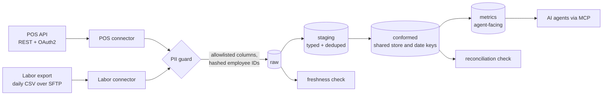

# restaurant-data-pipeline

A small reference pipeline that moves restaurant operations data (point-of-sale checks and timekeeping shifts) into a layered warehouse that AI agents can safely read.

I built it as a compact example of how I approach this kind of work. It runs fully offline on synthetic data (DuckDB) and deploys to Google Cloud (BigQuery, Cloud Run, Cloud Scheduler, Secret Manager) with configuration only.



## What it shows

| Concern | How it's handled | Where |
|---|---|---|
| Flaky vendor APIs | Exponential backoff with jitter, honours `Retry-After`, token refresh on 401, pagination | `connectors/pos_api.py`, `retry.py` |
| File-based sources | SFTP CSV export with schema-drift detection (fails loudly if a required column disappears) | `connectors/labor_sftp.py` |
| Personal data | Per-source column allowlist, keyed hashing of employee IDs, and a value scan that **fails the batch** if an SSN or card number appears in an allowed field | `pii.py` |
| Idempotent loads | Each run replaces one business date in a transaction, so retries and backfills never duplicate | `warehouse/` |
| Layered modelling | `raw` (strings + load metadata) → `staging` (typed, deduped) → `conformed` (shared keys) → `metrics` | `dbt/models/` |
| Cross-source keys | A store crosswalk maps each system's location ID to one `store_key` | `dbt/seeds/store_crosswalk.csv` |
| Reconciliation | Share of store-days present in both POS and labor, enforced at ≥ 99% as a dbt test and a CLI check | `recon_store_day.sql`, `checks.py` |
| Freshness | dbt source freshness on load time plus a business-date lag check | `_sources.yml`, `checks.py` |
| Observability | Structured JSON logs ready for Cloud Logging metrics and alerts | `logging_utils.py`, `deploy/README.md` |
| No secrets in code | Env vars + Secret Manager in prod, service-account auth to BigQuery, a CI step that blocks committed keys | `config.py`, `.github/workflows/ci.yml` |
| Agent access | Documented, PII-free `metrics` tables with read-only access through MCP | `docs/agent-access.md` |

## Run it locally (about one minute)

```bash
python -m venv .venv && source .venv/bin/activate
pip install -e ".[dev]"

# 1. Ingest three days of synthetic data (mock POS API + local "SFTP" folder)
PYTHONPATH=src python -m pipeline ingest --source all --date 2026-11-15 --days 3 --mock

# 2. Build and test the warehouse layers
(cd dbt && dbt build --profiles-dir .)

# 3. Post-load checks
PYTHONPATH=src python -m pipeline freshness --today 2026-11-16
PYTHONPATH=src python -m pipeline reconcile --threshold 0.99

# Unit and integration tests
pytest -q
```

Then look at the agent-facing table:

```bash
python -c "import duckdb; print(duckdb.connect('warehouse.duckdb').sql('select * from metrics.store_day_metrics order by store_key, business_date'))"
```

## Project layout

```
src/pipeline/
  connectors/      POS API client, labor SFTP reader, in-process mock POS API
  warehouse/       DuckDB (local/CI) and BigQuery (prod) adapters with idempotent partition loads
  pii.py           allowlist, pseudonymisation and value scanning
  checks.py        freshness and reconciliation
  runner.py        extract -> scrub -> load for one source and day
dbt/
  models/staging   typed, deduplicated views over raw
  models/conformed dim_store, fct_sales_daily, fct_labor_daily
  models/metrics   recon_store_day, store_day_metrics (agent-facing)
  tests/           reconciliation threshold and generic tests
deploy/            Cloud Run job script and GCP setup, scheduling and alerting
RUNBOOK.md         what to do when an alert fires
```

## Sample data

`scripts/generate_sample_data.py` produces deterministic, **fully synthetic** data for five restaurants over three days. The labor export intentionally contains fake names, fake SSNs (999-prefixed, never valid) and pay rates so the PII guard has something to remove. No real data is included.

## Deploying

See [`deploy/README.md`](deploy/README.md) for the service account, Secret Manager, Cloud Run job, Cloud Scheduler and alerting setup, and [`RUNBOOK.md`](RUNBOOK.md) for operations.
